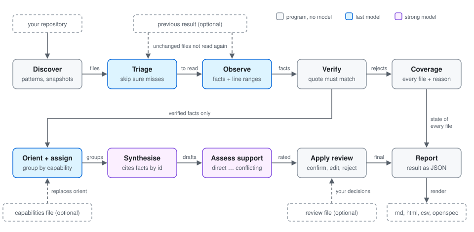

# backspec

Turn an unfamiliar codebase into a first draft of its requirements, with links to the code
behind every statement.

backspec reads source code, describes the behaviour it finds, and groups related requirements
into a report you can browse and review. Use it to understand a project you inherited, recover
missing documentation, or check which requirements need another look after the code changes.
Every citation is checked against the source, and the report records which files were read,
skipped or failed.

```bash
backspec extract ./my-service -o reqs.json
backspec render reqs.json --format html -o reqs.html
```

Open `reqs.html` in your browser to explore the report. It works offline.

backspec proposes requirements for you to review. It checks that the cited code exists, but
does not run that code or prove that a requirement is true.

## What you get

Each requirement describes a behaviour, the conditions under which it applies, and the code
that supports it. Related requirements are grouped into **capabilities**, such as stock
management or access control.

This example comes from a real run on [Grounded](https://github.com/adieyal/grounded-m1),
a tool that tracks requirements and their evidence. The wording is edited for readability:

> **If any of a rule's tests fails or errors, mark the rule as broken, regardless of other
> evidence. Explain why by naming each affected test and its outcome.**
>
> `REQ-a4ae6fab` · Support: `direct`
>
> Condition: At least one test has failed or errored.
>
> Evidence:
>
> - `grounded/modules/evidence/domain/status.py:39-42` (`rule_status`)
> - `grounded/modules/evidence/domain/status.py:42-42` (`rule_status`)
> - `tests/test_evidence_status.py:21-25` (`test_a_failed_or_errored_test_makes_the_rule_broken_whatever_else_holds`)
>
> Scenario: A rule has a failed test and an errored test. When its status is determined,
> it is marked as broken, with a reason naming each test and its outcome.

The `direct` label means the model judged that the cited code supports the statement.
The other assessed labels are `partial`, `insufficient` and `conflicting`. These are model
judgements to help you decide what to review, not proof of correctness.

That run produced 22 requirements in 5 capabilities. The report accounted for 16 files:
12 were read, and each of the other 4 had a reason recorded. It made 10 model calls and
cost $0.39. This is one run's result, not a cost estimate for other projects.

<details>
<summary>See the JSON behind this requirement</summary>

The saved result includes a quoted line of source code for each citation. This excerpt is
shortened, and uses the same edited wording as the example above:

```json
{
  "id": "REQ-a4ae6fab",
  "capability": "rule_status",
  "statement": "If any of a rule's tests fails or errors, mark the rule as broken, regardless of other evidence. Explain why by naming each affected test and its outcome.",
  "support": "direct",
  "support_note": "Lines 40-42 return broken with one 'name: outcome.' reason per failing/error test ...",
  "evidence": [
    {
      "path": "grounded/modules/evidence/domain/status.py",
      "lines": [39, 42],
      "quote": "return Verdict('broken', tuple(f'{test.name}: {test.outcome}.' for test in failing))",
      "symbol": "rule_status"
    }
  ]
}
```

</details>

## Quick start

You need Python 3.10 or later and the [Claude Code](https://claude.com/claude-code) command-line
tool, installed and logged in. backspec uses that login; you do not need to configure an API key.

From a clone of this repository, create a virtual environment and install backspec:

```bash
python3 -m venv .venv
source .venv/bin/activate
python3 -m pip install -e '.[treesitter]'
```

The `treesitter` extra lets backspec tell one function from another. Without it, files are
read as plain text, and requirements may join behaviour from different views or endpoints.
See [Optional language-aware parsing](#optional-language-aware-parsing).

Replace `./my-service` below with the path to the codebase you want to understand.
First, preview the files and estimated token usage. This sends nothing to a model:

```bash
backspec extract ./my-service --dry-run
```

Then extract the requirements and create a report:

```bash
backspec extract ./my-service -o reqs.json
backspec render reqs.json --format html -o reqs.html
```

Keep `reqs.json`: it contains the full result and lets you create other formats or reuse work
on later runs. Open `reqs.html` in a browser to review the requirements and their evidence.
For all available options, run `backspec --help` or `backspec extract --help`.

### Choose which files to read

Use gitignore-style patterns to focus on part of a project. You can repeat `--include` and
`--exclude`; an exclusion always takes precedence.

```bash
backspec extract ./my-service --include "src/**" --exclude "**/migrations/**" -o reqs.json
```

### Read only what the selected files call

A behaviour often depends on code in a large shared file, such as a models module, that is too
big to read in full. Name such files with `--follow` (gitignore-style, repeatable). They are
read only where the selected files call into them:

```bash
backspec extract ./app --include "/views/orders.py" --follow "/models.py" --follow-depth 2 -o reqs.json
```

backspec parses the selected files with tree-sitter, collects the names they call (`foo(...)`
and `x.foo(...)`), and reads the functions and methods of those names in the followed files.
It then follows the calls in those bodies, up to `--follow-depth` calls away (default 2). In
Python, an attribute used without a call (`run.signature = value`) reaches a `@property` or its
setter. Calling a class's name reaches its `__init__`; its other methods are read only if called.
Citations keep their real line numbers, and an observation outside the parts that were shown
is rejected. Only the reached functions get a second look.

Calls are matched by name, not by type, so a match can be wrong. Common names (`save`, `get`,
`filter`, `create` and others listed in `GENERIC_NAMES` in `src/backspec/modules/reach/domain.py`)
are never followed. A name defined more than three times in the followed files is not followed
either. A name defined two or three times is followed to every definition, and that ambiguity
is recorded. Calls through variables, `getattr` or framework hooks are not seen.

The result's `follow` section lists each followed file with the lines read, every reached symbol
with where it was called from, and every name not followed with the reason. Coverage marks
these files `read: in_part`. `--dry-run` shows the same plan without calling a model.
`backspec coverage` and the HTML report summarise it. Following needs the `treesitter` extra;
without it, nothing is followed and the result says so.

## Review and update requirements

### Choose how requirements are grouped

backspec can propose capabilities before it writes requirements. Edit the proposed groups
in `./my-service/backspec.capabilities.yaml`, then run extraction:

```bash
backspec orient ./my-service
# Edit ./my-service/backspec.capabilities.yaml, then:
backspec extract ./my-service -o reqs.json
```

Later runs use this file automatically. Use `orient --force` to replace it, or
`extract --capabilities PATH` to use a different file.

Each capability needs a unique id made of lowercase letters, digits and underscores, plus a
name. Invalid files are rejected with all problems listed. backspec adds a `plumbing` group
if it is missing.

To pause an extraction for this review, use `backspec extract ./my-service --gate`.
It writes the capabilities file if needed and stops before assigning facts or writing
requirements. The result has no requirements, with `run.status` set to `partial` and
`run.stopped_after` set to `capabilities`.

### Confirm, edit or reject a requirement

Record your decisions so later extractions can apply them. Replace `REQ-a4ae6fab` with an id
from your result and choose the action you need:

```bash
# Confirm a requirement.
backspec review reqs.json REQ-a4ae6fab --confirm --reviewer ana --review ./my-service/backspec.review.yaml

# Edit its statement and conditions.
backspec review reqs.json REQ-a4ae6fab --statement "Managers may adjust stock." --condition "Never below zero." --review ./my-service/backspec.review.yaml

# Reject it, with a reason.
backspec review reqs.json REQ-a4ae6fab --reject --note "Not a requirement" --review ./my-service/backspec.review.yaml
```

The explicit `--review` path saves decisions in the codebase being analysed, where the next
extraction finds them automatically:

```bash
backspec extract ./my-service -o reqs.json
```

Without `--review`, the review command writes `backspec.review.yaml` in your current directory.
For extraction, `--review PATH` selects a different review file.

Rejected requirements remain in the result under `hidden`, with counts in `diagnostics.review`.
If the cited code changes after a decision, the requirement returns as `needs_review`.
Decisions that no longer match a requirement are listed as stale.

backspec matches requirements between runs by overlap in their cited code, so a reworded
statement can keep its id.

### Reuse work when the code changes

Run extraction again with the same output path:

```bash
backspec extract ./my-service -o reqs.json
```

backspec uses the existing JSON result to avoid repeating work. You can also choose an earlier
result with `--previous FILE`.

- Unchanged files keep their observations and initial screening decisions.
- Changed files are read around the changed lines. Observations from untouched lines are kept,
  and their citations move with the code.
- Previous capabilities are reused unless a capabilities file overrides them.
- Groups with unchanged observations keep their requirements and support assessments.

If nothing has changed, no model is called and the same requirements are returned. Results
made with a different prompt version are not reused. Use `--no-reuse` to read everything again.

### Find requirements affected by code changes

To check a saved result without calling a model:

```bash
backspec status reqs.json --root ./my-service
```

The command lists requirements whose cited files have changed (`stale`) or disappeared
(`source_missing`). A changed file means the requirement needs another look; it does not by
itself mean the requirement is broken.

Use `--json` for a machine-readable report. The exit code is 0 when everything is current,
1 when something is stale or missing, and 2 when the input is not a valid result file.

### Check result quality and file coverage

```bash
backspec validate reqs.json
backspec validate reqs.json --strict
backspec coverage reqs.json
```

`validate` checks the result's structure and applies checks that do not use a model. Invalid
citations, unknown capabilities and duplicate ids are errors. Vague statements, statements
combining several requirements, and weak support are warnings. The same checks run during
extraction and are saved in `diagnostics.lint`.

Validation exits 0 when there are no errors, 1 when there are errors, and 2 for an invalid
result file. With `--strict`, warnings also cause exit code 1. Use `--json` for the findings
as JSON.

`coverage` shows how files were handled, which observations were unused, and files that may
need attention. Use `--all` for the full list or `--json` for structured output.

## Export and share results

JSON is the full saved result. You can turn it into any of these formats without another
model call:

| Format | Use it for |
| --- | --- |
| Markdown (`md`) | Reading or editing requirements grouped by capability, with conditions, evidence and scenarios. This is the default for `render`. |
| HTML (`html`) | Browsing a report offline, opening requirements to inspect their evidence, and finding items that need review. |
| CSV (`csv`) | Working in a spreadsheet, with one row per requirement and citation. Add `--include-hidden` to include rejected requirements. |
| OpenSpec (`openspec`) | Creating a specification directory with one file per capability. See the export rules below. |

```bash
backspec render reqs.json -o REQUIREMENTS.md
backspec render reqs.json --format html -o reqs.html --title "My service"
backspec render reqs.json --format csv -o reqs.csv
backspec render reqs.json --format openspec -o spec/
```

You can also extract straight to another format, for example
`backspec extract ./my-service --format csv -o reqs.csv`. Keep a JSON result if you want to
reuse it on later runs. `backspec schema` prints the result's JSON Schema.

The HTML report's "To review" section includes requirements with less than direct support,
plus expandable open questions, validation findings and failures. "Coverage" shows each
file's state. The page loads nothing from the network; its design is described in
[`DESIGN.md`](DESIGN.md).

OpenSpec exports write `specs/<capability>/spec.md`, `NOT_EXPORTED.md` and `README.md`.
They include only requirements with `direct` or `partial` support. By default, a requirement
must also have a scenario drawn from a cited test or example in the source. backspec does
not invent scenarios. Use `--no-strict` to include requirements without scenarios and label
that omission. This format requires an output directory via `-o`.

## Manage cost

Preview a run or set a token budget:

```bash
backspec extract ./my-service --dry-run
backspec extract ./my-service --max-tokens 400000 -o reqs.json
```

The budget is a soft limit. Before each model call, backspec adds the tokens already used,
the tokens reserved for calls in progress, and the estimate for the new call. If the total
would exceed the limit, it does not send the new call. The run is marked `partial`,
`run.budget_reached` is set to true, and the command exits 1. Calls already in progress can
still exceed the budget if they use more tokens than estimated.

Every run records input and output tokens and usage by stage in `run.input_tokens`,
`run.output_tokens` and `run.usage_by_stage`. Cost is included when the model backend reports
it. When usage is unavailable, backspec estimates tokens as characters divided by four and
sets `run.tokens_estimated` to true. Cached replies count as zero usage.

### Inspect or clear cached model replies

backspec caches replies using the full prompt, so an identical request can reuse a previous
reply. Use `--replay` to require cached replies and fail on any cache miss.

```bash
backspec cache info ./my-service
backspec cache clear ./my-service --yes
```

`cache info` shows the cache folder, replies per stage and size. Use `--cache-dir PATH` to
select a different folder. Without `--yes`, `cache clear` only reports what it would delete.
It deletes only files named `<stage>-<hex>.json` and refuses folders containing anything else.

## How extraction works

backspec first collects observations from the source, then turns them into requirements.
The model reads code and writes statements. The program checks quotes, copies citations
and records what happened to each file.



1. **Find files.** Apply the include and exclude patterns, then snapshot the files to read.
2. **Screen files, called triage.** A fast model looks at each file's path, size and first
   40 lines. It can skip files it judges to contain no user-visible behaviour. A sample is
   read anyway to check those decisions. Adjust the sample with `--triage-audit`, or use
   `--no-triage` to read every selected file in full.
3. **Collect observations.** A fast model reads the selected files with line numbers and
   reports individual facts, each with a line range and an exact quote.
4. **Verify quotes.** The program keeps an observation only if its quote is present in the file.
5. **Group observations.** Propose capabilities or load your capabilities file, then assign
   observations to those groups.
6. **Write requirements.** A stronger model writes requirements using observation ids.
   The program copies the corresponding source locations into citations.
7. **Assess support.** A separate model call judges how well the cited code supports each statement.
8. **Apply your review.** Apply recorded confirmations, edits and rejections.
9. **Report results.** Include requirements, observations, file coverage and rejected items.

### What the checks establish

Every citation points to real lines in the source snapshot. Files that are excluded, skipped
or fail are accounted for, and a run with a failed stage is marked `partial`. Evidence that
only shows something exists cannot earn a rating above `insufficient`.

These checks do not establish that a requirement is true, that all requirements have been
found, or that the cited code can actually run. backspec reads code; it does not execute it.
The support assessment remains a model's judgement.

For integrations, each file has exactly one state in the result: `excluded`, `skipped`,
`triaged_out`, `extracted`, `no_requirements`, `candidates_rejected` or `failed`.

## Use backspec from Python

```python
from backspec import Config, extract

result = extract("./my-service", Config(include=["src/**"]))
for requirement in result.requirements:
    print(requirement.id, requirement.support, requirement.statement)
```

`backspec.status(result_or_path, root)` checks for changed source files.
`backspec.validate(result_or_path)` checks a saved result's structure and quality.

## Choose a model backend

The default backend uses the Claude Code command-line tool with tools and settings disabled.
Haiku handles file screening, observations and grouping. Sonnet writes requirements and
assesses support. Use `--fast-model` and `--model` to change these choices.

`--provider codex` selects the Codex command-line tool, using `codex exec` with a read-only
sandbox and the prompt on standard input. **This adapter has only been tested against a fake
`codex` script, not the real CLI.** Check its flags in
[`src/backspec/host/adapters/codex.py`](src/backspec/host/adapters/codex.py) before relying on it.

To supply another backend from Python, pass an object with a `complete(request) -> str` method
as `Config(provider=...)`.

## Optional language-aware parsing

backspec can read files as plain text without a parser. To help it split large files at
function and class boundaries, install the optional parser from your clone:

```bash
python3 -m pip install -e '.[treesitter]'
```

This uses `tree-sitter-language-pack` for Python, JavaScript, TypeScript, TSX, Go, Java, Ruby,
Rust, C# and PHP. It also adds the enclosing function, method or class name to observations
and citations as `symbol`. The models that write and check requirements are shown that name,
so that two operations which do similar things are not merged into one requirement. Any
function in which the first reading recorded nothing is shown to a model a second time; those
still empty are listed in `diagnostics.unobserved_functions` and in the report. The field `coverage.files[].analysis` records whether a file was
read using `syntax` or `text` analysis.

Other languages, missing parsers and parsing failures fall back to plain text. Use
`--text-only`, or `Config(syntax=False)` in Python, to always read files as text.

## Project status

This is an early release. It has been run end to end on a small slice of a real Python
codebase. Its automated tests use a fake model, and the accuracy of the extracted requirements
has not yet been checked by a person. The Codex adapter has not been tested with the real CLI.

## Development

Install the development dependencies and run the tests:

```bash
python3 -m pip install -e '.[dev]'
python3 -m pytest -q
```

Each capability lives under `src/backspec/modules/`, with rules and models in `domain.py`,
workflows in `use_cases.py`, a small public interface in `facade.py`, and external interfaces
in `ports.py` where needed. File access, model backends and application wiring live in
`src/backspec/host/`. Import boundaries are checked by `tests/test_architecture.py`.
See [`AGENTS.md`](AGENTS.md) for contribution rules.

To add an output format, add a function to `src/backspec/modules/report/renderers.py` and
register it in `RENDERERS`.

## Licence

MIT; see [`LICENSE`](LICENSE). The HTML report embeds the Libre Baskerville font under the
[SIL Open Font Licence](src/backspec/templates/libre-baskerville-OFL.txt).
